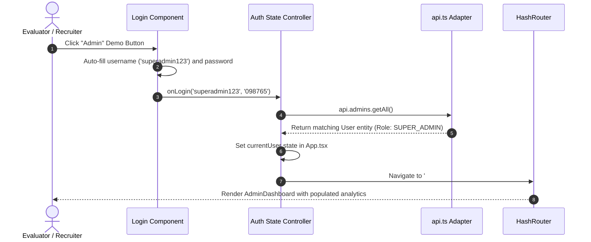
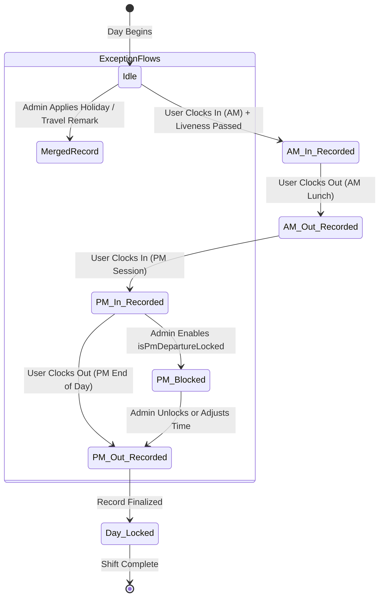

# Application Flow & User Journeys (APP_FLOW)
## TrackMyHours — Interaction Architecture, Route Matrix & Journey Maps

---

## 1. Global Navigation Architecture

The application implements a role-driven routing structure. When users authenticate, the system evaluates their role (`SUPER_ADMIN`, `ADMIN`, `EMPLOYEE`, `STUDENT`) and automatically redirects them to their designated portal.

```mermaid
flowchart TD
    START([User Enters App]) --> LOGIN[Login Portal: /]
    
    LOGIN -->|Credentials or Demo Button| AUTH_CHECK{Authenticate}
    LOGIN -->|Scan QR Code| QR_MODAL[Camera QR Scanner]
    QR_MODAL -->|Valid QR Token| AUTH_CHECK

    AUTH_CHECK -->|Role: SUPER_ADMIN| ADMIN_FLOW[Super Admin Portal]
    AUTH_CHECK -->|Role: ADMIN| ADMIN_FLOW
    AUTH_CHECK -->|Role: EMPLOYEE| EMP_FLOW[Employee Portal]
    AUTH_CHECK -->|Role: STUDENT| STU_FLOW[Student / Intern Portal]
    AUTH_CHECK -->|Deactivated / Invalid| ERR[Access Denied / Account Deactivated]

    subgraph Admin & Super Admin Views
        ADMIN_FLOW --> ADM_DASH[Dashboard: /admin]
        ADMIN_FLOW --> ADM_STU[Student Management: /admin/students]
        ADMIN_FLOW --> ADM_EMP[Employee Management: /admin/employees]
        ADMIN_FLOW --> ADM_ATT[Attendance Records: /admin/attendance]
        ADMIN_FLOW --> ADM_INPUT[Manual Time Input: /admin/attendance-input]
        ADMIN_FLOW --> ADM_DOCS[Document Links: /admin/document-links]
        ADMIN_FLOW --> ADM_NOTIF[Notification Center: /admin/notifications]
        ADMIN_FLOW --> ADM_LOGS[Audit Activity Logs: /admin/logs]
        ADMIN_FLOW --> ADM_ARCH[Archived Users: /admin/archived]
    end

    subgraph Employee Views
        EMP_FLOW --> EMP_DASH[Dashboard: /employee]
        EMP_FLOW --> EMP_DTR[DTR Sheet: /employee/dtr]
        EMP_FLOW --> EMP_REALTIME[Real-time Clock: /realtime]
        EMP_FLOW --> EMP_ASSIGN[Document Directives: /employee/assignments]
        EMP_FLOW --> EMP_PROF[Profile: /employee/profile]
    end

    subgraph Student Views
        STU_FLOW --> STU_DASH[Dashboard: /student]
        STU_FLOW --> STU_DTR[DTR Sheet: /student/dtr]
        STU_FLOW --> STU_REALTIME[Real-time Clock: /realtime]
        STU_FLOW --> STU_LOGS[Activity History: /student/logs]
        STU_FLOW --> STU_PROF[Profile & Certificate: /student/profile]
    end
```

---

## 2. Role-Based Route Protection Matrix

| Route Path | Allowed Roles | Description | Redirection if Unauthorized |
| :--- | :--- | :--- | :--- |
| `/` | Public | Login, Demo Accounts, QR Scanner, Forgot Password | Auto-redirects to active dashboard |
| `/admin/*` | `SUPER_ADMIN`, `ADMIN` | System controls, user lists, manual edits, audit logs | Redirect to `/` |
| `/employee/*` | `EMPLOYEE` | Employee dashboard, DTR viewer, regional documents | Redirect to `/` |
| `/student/*` | `STUDENT` | Intern dashboard, completion metrics, DTR generator | Redirect to `/` |
| `/realtime` | `ALL AUTHENTICATED` | Full-screen kiosk clock with edge face verification | Redirect to `/` |

---

## 3. Detailed User Journeys

### 3.1 Journey 1: Authentication & Demo Mode Access
1. **Entry:** User arrives at `/` (Login Page).
2. **Path A — 1-Click Demo:** User clicks `Admin`, `Student`, or `Employee` button. Input fields auto-fill and submit with a 100ms smooth debounce.
3. **Path B — QR Code Scan:** User clicks "Scan QR". The camera initializes. When a valid encoded student/employee badge token is detected, the system validates the token and logs the user in.
4. **Path C — Biometric Setup:** On first login, users may enroll their profile photo for subsequent facial match comparison.

---

### 3.2 Journey 2: Biometric Clock In / Clock Out (Split-Shift)
1. **Initiate:** From Student or Employee Dashboard, user clicks `Clock In` or `Clock Out`.
2. **Session Determination:** System calculates current local time against daily thresholds:
   * **AM Arrival (`amIn`):** Before 12:00 PM.
   * **AM Departure (`amOut`):** Between 11:30 AM and 1:00 PM.
   * **PM Arrival (`pmIn`):** After 12:00 PM.
   * **PM Departure (`pmOut`):** After 4:00 PM (subject to `isPmDepartureLocked`).
3. **Liveness Verification:** WebRTC camera opens. User blinks and holds head still for 2.0 seconds.
4. **Audit & Persistence:** Timestamp is saved, undertime is computed, and an entry is pushed to `ActivityLog`.

---

### 3.3 Journey 3: DTR Review, Calendar Notes, and PDF Export
1. User navigates to `/student/dtr` or `/employee/dtr`.
2. System groups attendance logs by Year and Month.
3. User selects the active cut-off period (e.g., 1st - 15th, 16th - 31st, or Full Month).
4. Table displays daily AM/PM columns, daily rendered minutes, accrued undertime, and calendar notes.
5. User clicks **Export DTR (PDF)**:
   * Client-side `pdfService.ts` constructs Civil Service Form 48 in memory.
   * Prompts instant browser download of `<Name>_DTR_<Month>_<Year>.pdf`.

---

### 3.4 Journey 4: Super Admin Governance & Time Adjustment
1. Admin logs into `/admin`.
2. Views real-time active headcounts, student hour completion progress bars, and recent activity logs.
3. Navigates to `/admin/attendance-input` to perform manual overrides:
   * Selects Student or Employee from autocomplete dropdown.
   * Adjusts AM/PM timestamps for forgotten punches.
   * Toggles `isMerged` to convert a row into a spanned non-working holiday or official travel banner.
4. Changes instantly propagate to the student's DTR view and recalculate completion percentages.

---

### 3.5 Journey 5: AI Assistant Interaction & Simulated Tools
1. User clicks the floating Chatbot icon on bottom-right.
2. Selects from suggested chips (e.g., *"How do I log my attendance?"*, *"What should I do if I forgot to clock out?"*, or *"Show me how this system works"*).
3. The chatbot responds:
   * Explains the workflow directly.
   * Dispatches automated tool triggers (e.g., `notifyAdmin`) to simulate government ticketing.
   * Saves notification to the Super Admin inbox (`AdminNotifications.tsx`).
