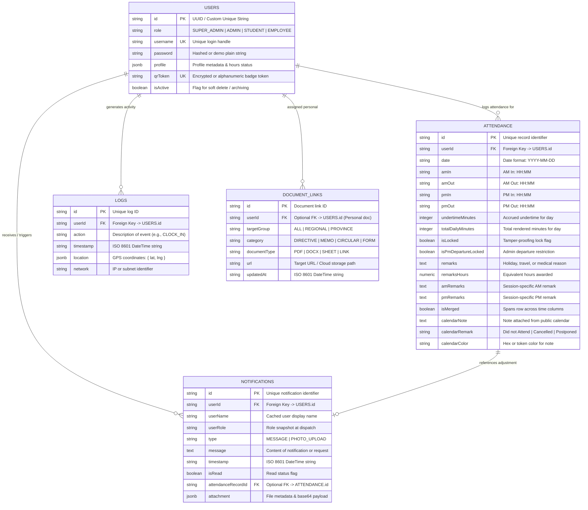
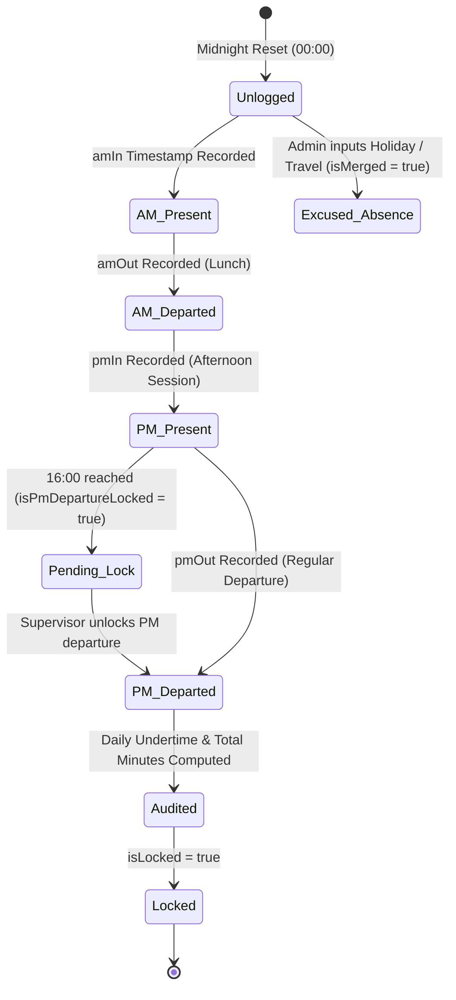
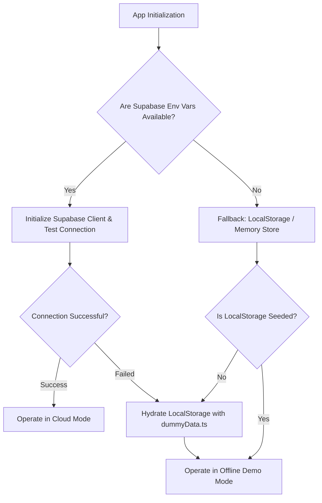

# Background Schema & Data Models (BACKGROUND_SCHEMA)
## TrackMyHours — Relational Schema, Entity Models, State Machines & Storage Layer

---

## 1. Entity-Relationship Diagram (ERD)



---

## 2. Table Data Dictionaries

### 2.1 `users` Table
Stores authentication credentials, organizational roles, and serialized profile metadata.

| Column | Type | Constraints | Description |
| :--- | :--- | :--- | :--- |
| `id` | `TEXT` | `PRIMARY KEY` | Unique identifier (e.g. `student-1`, `emp-123`, or UUID). |
| `role` | `TEXT` | `NOT NULL` | One of `SUPER_ADMIN`, `ADMIN`, `EMPLOYEE`, `STUDENT`. |
| `username` | `TEXT` | `UNIQUE, NOT NULL` | Login identifier. |
| `password` | `TEXT` | `NOT NULL` | Encrypted credential string. |
| `profile` | `JSONB` | `NOT NULL` | Detailed profile attributes (see Section 3.1). |
| `qrToken` | `TEXT` | `UNIQUE, NULLABLE` | Distinct token used for camera QR badge authentication. |
| `isActive` | `BOOLEAN` | `DEFAULT TRUE` | Soft-delete flag; if false, session is terminated. |

### 2.2 `attendance` Table
Primary ledger for daily time tracking.

| Column | Type | Constraints | Description |
| :--- | :--- | :--- | :--- |
| `id` | `TEXT` | `PRIMARY KEY` | Unique record key (e.g. `rec-student-1-2026-08-15`). |
| `userId` | `TEXT` | `REFERENCES users(id) ON DELETE CASCADE` | Identity reference. |
| `date` | `TEXT` | `NOT NULL` | ISO date string (`YYYY-MM-DD`). |
| `amIn` | `TEXT` | `NULLABLE` | Morning arrival time (`HH:MM`). |
| `amOut` | `TEXT` | `NULLABLE` | Morning lunch break departure (`HH:MM`). |
| `pmIn` | `TEXT` | `NULLABLE` | Afternoon return time (`HH:MM`). |
| `pmOut` | `TEXT` | `NULLABLE` | Afternoon departure time (`HH:MM`). |
| `undertimeMinutes` | `INTEGER` | `DEFAULT 0` | Minutes below standard 8-hour requirement. |
| `totalDailyMinutes`| `INTEGER` | `DEFAULT 0` | Sum of valid morning and afternoon rendered minutes. |
| `isLocked` | `BOOLEAN` | `DEFAULT FALSE` | Prevents subsequent client modifications. |
| `isPmDepartureLocked` | `BOOLEAN` | `DEFAULT FALSE` | Prevents PM departure without supervisor release. |
| `remarks` | `TEXT` | `NULLABLE` | Full-day remark (e.g. "National Holiday", "Official Travel"). |
| `remarksHours` | `NUMERIC` | `DEFAULT 0` | Credited hours for approved non-working days. |
| `amRemarks` | `TEXT` | `NULLABLE` | Remark for morning session only. |
| `pmRemarks` | `TEXT` | `NULLABLE` | Remark for afternoon session only. |
| `isMerged` | `BOOLEAN` | `DEFAULT FALSE` | If true, DTR table spans remarks across all time columns. |

---

## 3. Complex JSON Structures

### 3.1 `profile` JSON Schema (`UserProfile`)
```json
{
  "$schema": "http://json-schema.org/draft-07/schema#",
  "title": "UserProfile",
  "type": "object",
  "properties": {
    "name": { "type": "string" },
    "username": { "type": "string" },
    "school": { "type": "string" },
    "schoolAddress": { "type": "string" },
    "program": { "type": "string", "example": "BS Information Technology" },
    "studentType": { "type": "string", "enum": ["OJT", "IMMERSION"] },
    "position": { "type": "string", "example": "Administrative Assistant II" },
    "department": { "type": "string", "example": "Management Information Systems" },
    "employeeType": { "type": "string", "enum": ["REGIONAL", "PROVINCE"] },
    "province": { "type": "string" },
    "requiredHours": { "type": "number", "example": 486 },
    "completedHours": { "type": "number", "description": "Stored in minutes" },
    "hoursApproved": { "type": "boolean" },
    "dateStarted": { "type": "string", "format": "date" },
    "profilePicture": { "type": "string", "description": "Base64 encoded string" },
    "certificateLink": { "type": "string", "format": "uri" }
  },
  "required": ["name", "username", "completedHours"]
}
```

---

## 4. State Machines & Business Logic

### 4.1 Attendance Daily Transition State Machine



### 4.2 Undertime & Total Rendered Calculation Formulas
1. **Morning Session Rendered:**
   $$\text{Minutes}_{AM} = \max\left(0, \min(t_{\text{amOut}}, 12:00) - \max(t_{\text{amIn}}, 08:00)\right)$$
2. **Afternoon Session Rendered:**
   $$\text{Minutes}_{PM} = \max\left(0, \min(t_{\text{pmOut}}, 17:00) - \max(t_{\text{pmIn}}, 13:00)\right)$$
3. **Daily Total Minutes:**
   $$\text{Total Daily} = \text{Minutes}_{AM} + \text{Minutes}_{PM} + (\text{remarksHours} \times 60)$$
4. **Undertime Minutes:**
   $$\text{Undertime} = \max\left(0, 480 - \text{Total Daily}\right)$$

---

## 5. Dual-Storage Fallback & Synchronization Engine

The application implements an intelligent dual-mode storage adapter in `services/api.ts`:



* **Zero Breakage Guarantee:** If an interviewer clones the repo or runs it on Vercel without creating a Supabase project, `dummyData.ts` immediately populates 10+ students, employees, activity logs, and historical attendance records into `localStorage`.
