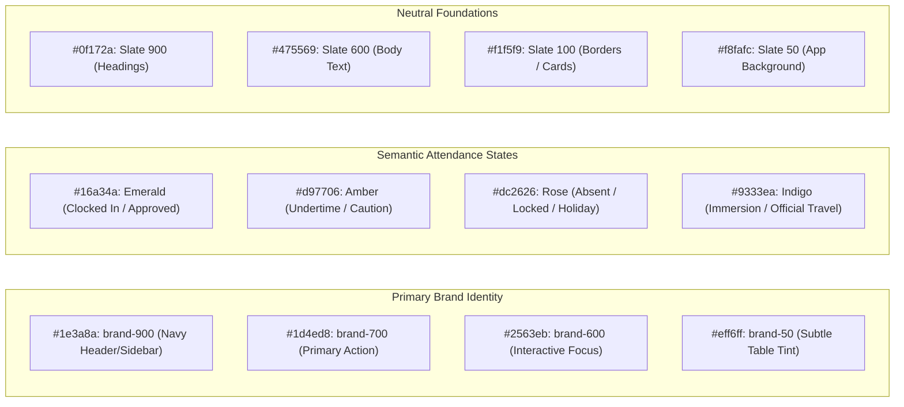
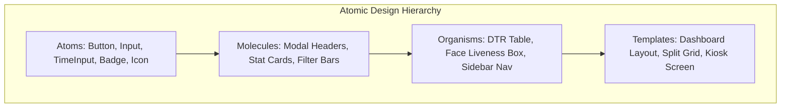

# Design Brief & UI/UX Constitution (DESIGN_BRIEF)
## TrackMyHours — Visual Identity, Typography, Color Tokens & Component Design System

---

## 1. Design Philosophy & Brand Identity

TrackMyHours adheres to an **Institutional-Grade Utility** design aesthetic. Modeled after modern enterprise software deployed within civil service and statutory government agencies, the interface balances:

1. **High Visual Trust & Authority:** Deep navy and cobalt blues communicate reliability, data integrity, and compliance.
2. **Dense Tabular Clarity:** Timekeeping and Civil Service forms demand pixel-perfect tabular alignment, monospace numerical figures, and zero extraneous fluff.
3. **Calm Functionalism:** Colors are reserved strictly for semantic states (on-time, late, undertime, locked, merged).
4. **Accessible Biometrics:** Clear, high-contrast camera guidance overlays that direct users effortlessly through face recognition without intimidation.

---

## 2. Color System & Design Tokens

### 2.1 Color Palette Specifications

| Token | Hex Code | Tailwind Equivalent | Usage & Role |
| :--- | :--- | :--- | :--- |
| `brand-900` | `#1e3a8a` | `bg-blue-900` | Sidebar navigation, primary institutional header. |
| `brand-700` | `#1d4ed8` | `bg-blue-700` | Primary buttons, active tabs, modal action bars. |
| `brand-600` | `#2563eb` | `bg-blue-600` | Hover states, primary interactive links. |
| `brand-100` | `#dbeafe` | `bg-blue-100` | Accent badges, subtle card highlights. |
| `surface-bg` | `#f8fafc` | `bg-slate-50` | Global canvas background. |
| `card-bg` | `#ffffff` | `bg-white` | Elevated surface containers with `shadow-sm`. |
| `border-subtle`| `#e2e8f0` | `border-slate-200` | Structural dividers, table borders, input strokes. |
| `success` | `#16a34a` | `text-emerald-600` | Verified liveness, completed hours target reached. |
| `warning` | `#d97706` | `text-amber-600` | Accrued undertime, pending supervisor approvals. |
| `danger` | `#dc2626` | `text-rose-600` | Deactivated accounts, locked departures, validation errors. |

---

## 3. Typography Hierarchy & Rules

The typographic system utilizes a clean, modern sans-serif stack (`Inter`, `system-ui`, `-apple-system`, `sans-serif`) paired with monospace numerical figures for tabular attendance records.

| Scale Token | Font Size | Line Height | Weight | Application |
| :--- | :--- | :--- | :--- | :--- |
| `Display 1` | `30px (1.875rem)` | `36px` | Bold (`700`) | Login title, main dashboard KPI counters. |
| `Heading 1` | `24px (1.5rem)` | `32px` | Bold (`700`) | Page headers (e.g., "Student Management"). |
| `Heading 2` | `18px (1.125rem)` | `28px` | SemiBold (`600`) | Card titles, modal headers, section labels. |
| `Body Regular` | `14px (0.875rem)` | `20px` | Regular (`400`) | Standard body text, descriptions, table cells. |
| `Body Medium` | `14px (0.875rem)` | `20px` | Medium (`500`) | Table column headers, button labels, tabs. |
| `Caption / Monospace` | `12px (0.75rem)` | `16px` | Medium (`500`) | AM/PM timestamps (`HH:MM`), QR tokens, badges. |

### 3.1 Tabular Figures Rule
All clock times (`08:00 AM`, `05:00 PM`) and numeric durations are styled with `font-variant-numeric: tabular-nums` or `font-mono` to prevent horizontal jitter when values update in real time.

---

## 4. UI Component Design Constitution

### 4.1 Buttons
* **Primary:** Solid `brand-700` background with crisp white typography. Hover transition to `brand-800` with subtle elevation (`shadow-sm`).
* **Outline:** 1px `border-slate-300` on white background with `text-slate-700`. Used for secondary actions, cancellations, and filter toggles.
* **Danger:** Rose background (`bg-rose-600`) for destructive actions (deactivating users, resetting records).
* **Demo Chips:** Specially styled outlined buttons with small icons designed to allow instantaneous one-click evaluator login.

### 4.2 Time Input & Split-Shift Matrix
* Built with custom `<TimeInput />` component that handles 12-hour/24-hour conversions cleanly.
* Automatically disables or dims inputs when rows are flagged with `isLocked` or marked with non-working remarks.

### 4.3 Biometric Camera Viewport
* Rounded rectangular viewport (`rounded-2xl`) with an aspect ratio of 4:3.
* Subtle animated scanner line overlay (emerald-500) indicating real-time edge face detection.
* Clear visual status indicator at bottom: "Center Face", "Blink to Verify", or "Verified".

### 4.4 The AI Chat Widget
* Fixed position on bottom right (`bottom-6 right-6`).
* Collapsible floating trigger with badge indicator.
* Smooth modal fly-out featuring suggested prompt pills, drag-and-drop document upload, and markdown-rendered bot responses.

---

## 5. Accessibility & Responsive Viewport Rules

1. **Color Contrast:** All body text meets WCAG AA standards (minimum contrast ratio `4.5:1` against white and slate backgrounds).
2. **Keyboard Navigation:** All modal dialogs (Public Calendar, QR Scanner, Face Liveness) support `Escape` key dismissal and `Tab` focus trapping.
3. **Mobile Adaptability:**
   * Desktop (> 1024px): Persistent, collapsible sidebar with 256px fixed width.
   * Mobile (< 768px): Header hamburger drawer toggle; data tables switch to horizontal scrolling containers with frozen date columns.
