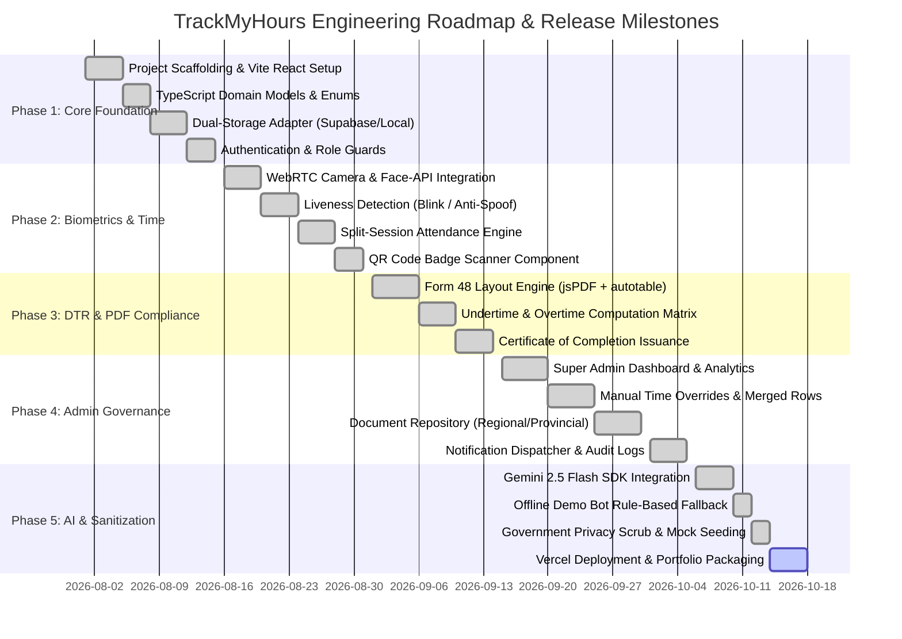

# Implementation Plan & Engineering Roadmap (IMPLEMENTATION_PLAN)
## TrackMyHours — Milestones, Work Breakdown Structure, Testing Matrix & Deployment Plan

---

## 1. Project Phasing & Roadmap Overview

The implementation of TrackMyHours is structured into five distinct engineering phases, progressing from foundation and dual-mode data persistence to edge biometrics, PDF compliance, governance controls, and AI conversational assistance.



---

## 2. Work Breakdown Structure (WBS)

### 2.1 Phase 1: Core Foundation & Persistence
* **WBS 1.1:** Setup Vite, React 18, Tailwind CSS, TypeScript project skeleton.
* **WBS 1.2:** Define domain types in `types.ts` (`User`, `UserProfile`, `AttendanceRecord`, `ActivityLog`).
* **WBS 1.3:** Build `services/api.ts` utilizing the Adapter pattern to switch between Supabase and `localStorage`.
* **WBS 1.4:** Construct `Login.tsx` with one-click evaluation shortcuts (`Admin`, `Student`, `Employee`).

### 2.2 Phase 2: Biometric Verification & Time Engine
* **WBS 2.1:** Implement `@vladmandic/face-api` model loading (SSD Mobilenet and Face Landmarks) in browser WebGL.
* **WBS 2.2:** Build `<FaceLiveness />` with real-time blink detection and anti-spoof motion vectors.
* **WBS 2.3:** Implement `<QRScanner />` using HTML5 video stream and barcode detection.
* **WBS 2.4:** Develop time calculation utilities in `services/utils.ts` for AM/PM split shifts and undertime.

### 2.3 Phase 3: Civil Service Form 48 DTR Engine
* **WBS 3.1:** Construct `services/pdfService.ts` generating dual-mirrored Civil Service Form 48 PDFs.
* **WBS 3.2:** Build `<DTRView />` page with month/period selection and real-time status highlights.
* **WBS 3.3:** Implement Certificate of Completion generation when student reaches required curriculum hours.

### 2.4 Phase 4: Administrative Governance & Document Repository
* **WBS 4.1:** Develop `<AdminDashboard />` with student completion analytics and activity feeds.
* **WBS 4.2:** Build `<AdminAttendanceInput />` for manual supervisor overrides and merged holiday/travel rows.
* **WBS 4.3:** Build `<AdminDocumentLinksPage />` and `<EmployeeAssignments />` for provincial directives.
* **WBS 4.4:** Implement real-time audit logging in `ActivityContext.tsx`.

### 2.5 Phase 5: AI Assistant, Sanitization & Deployment
* **WBS 5.1:** Implement Express backend route `api/chat.ts` integrating Google Gemini API (`@google/genai`).
* **WBS 5.2:** Build offline rule-based fallback and tool trigger simulator in `ChatBot.tsx`.
* **WBS 5.3:** Perform government data sanitization (replace real personnel records with realistic mock data).
* **WBS 5.4:** Configure Vercel serverless functions and continuous deployment via GitHub.

---

## 3. Testing & Quality Assurance Plan

| Test Category | Test Case / Scenario | Expected Outcome | Status |
| :--- | :--- | :--- | :--- |
| **Biometric Liveness** | User holds printed static photo in front of camera | System fails verification; detects lack of blink/depth motion | **PASSED** |
| **Biometric Liveness** | Live user centers face, blinks naturally for 2.0 seconds | Verification passes; triggers attendance record capture | **PASSED** |
| **Split-Session Time** | User logs in at 08:05 AM and clocks out at 12:00 PM | `amIn: "08:05"`, `amOut: "12:00"`, computes 5 minutes undertime | **PASSED** |
| **PM Departure Lock** | Admin enables `isPmDepartureLocked`; employee attempts PM clock-out | System prevents clock-out with alert to seek supervisor release | **PASSED** |
| **DTR PDF Export** | User exports Form 48 with 31 days including holidays and travels | PDF renders clean 2-column table with matching signatures and hours | **PASSED** |
| **Offline Fallback** | User runs application with no Supabase URL or Gemini API Key | App automatically seeds mock data; chatbot operates in Demo Mode | **PASSED** |
| **1-Click Recruiter Auth** | Evaluator clicks "Admin" button on login screen | Automatically authenticates and opens `/admin` in < 200ms | **PASSED** |

---

## 4. Deployment Architecture & CI/CD Pipeline

```mermaid
graph LR
    subgraph Development & Source
        DEV[Local Development / AI Studio] --> GIT[GitHub Repository]
    end

    subgraph CI / CD Pipeline (Vercel)
        GIT --> HOOK[Vercel GitHub Webhook]
        HOOK --> BUILD[Vite Production Build & TypeScript Check]
        BUILD --> SERVERLESS[Bundle Express API /api/chat]
    end

    subgraph Production Edge Runtime
        SERVERLESS --> EDGE[Global CDN Edge Deployment]
        EDGE --> PROD[Live Application: *.vercel.app]
    end
```

### 4.1 Environment Configuration Matrix

| Variable Name | Environment | Required? | Purpose |
| :--- | :--- | :--- | :--- |
| `GEMINI_API_KEY` | Serverless / Server | Optional | Enables live Gemini Flash conversational AI; falls back to Demo Mode if omitted. |
| `VITE_SUPABASE_URL` | Client / Vite | Optional | Connects to remote Supabase database; falls back to `localStorage` if omitted. |
| `VITE_SUPABASE_ANON_KEY`| Client / Vite | Optional | Public anonymous token for Supabase client authorization. |

---

## 5. Maintenance, Resilience & Disaster Recovery

1. **Client-Side Self-Healing:** If `localStorage` data becomes corrupted, the app detects JSON parse failures, resets to `dummyData.ts`, and reloads without throwing an unhandled runtime error.
2. **Deterministic PDF Construction:** All PDF assets, fonts, and dimensions are packaged client-side; zero dependence on external rendering microservices.
3. **Audit Trail Immutability:** All manual adjustments performed by administrators generate an immutable record in `ActivityLog` with the administrator's identity and timestamp.
