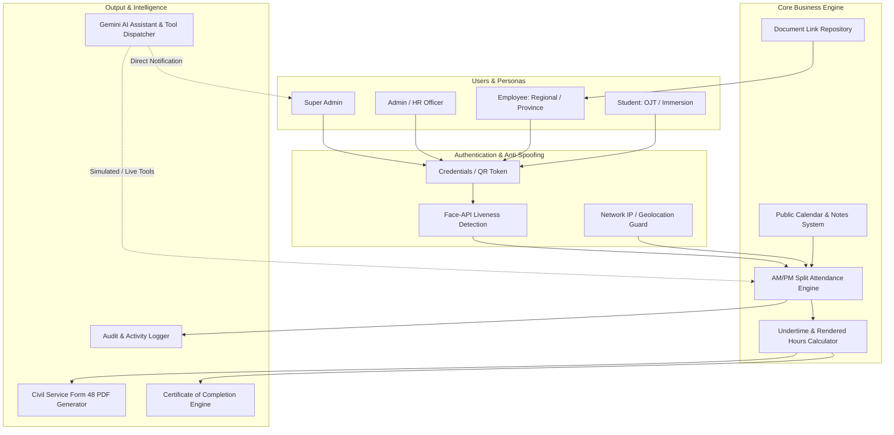

# Product Requirements Document (PRD)
## TrackMyHours — Intelligent Daily Time Record & Biometric Attendance System

---

## 1. Executive Summary & Background

### 1.1 Context
In enterprise and government organizations, accurate recording of working hours is a legal, operational, and financial necessity. The traditional manual Daily Time Record (DTR)—such as Civil Service Form 48—often suffers from manual logging inaccuracies, proxy attendance ("buddy punching"), tedious calculation of undertime and overtime, and delayed record consolidation.

**TrackMyHours** was originally engineered as an automated, tamper-resistant time-tracking platform for public sector organizations and academic internship programs (OJT and Immersion). This public repository represents a **sanitized, open-source portfolio edition** where all sensitive government data, live production credentials, and proprietary branding have been anonymized or replaced with representative mock data.

### 1.2 Vision Statement
To provide a friction-free, verifiable, and intelligent attendance management platform that seamlessly unifies edge-based biometric verification, automated Civil Service-compliant DTR generation, role-based workflows, and conversational AI assistance.

---

## 2. Problem Statement & Business Objectives

### 2.1 Problem Statement
1. **Attendance Spoofing & Buddy Punching:** Traditional paper logbooks or simple barcode scanners permit colleagues to log hours on behalf of absent peers.
2. **Administrative Overhead:** HR officers and internship coordinators spend dozens of hours each cut-off manually aggregating AM/PM arrival/departure times, calculating undertime, verifying excuse slips, and printing physical records.
3. **Inflexible Shift & Session Architecture:** Existing systems struggle to model split-session requirements (AM In/Out, PM In/Out, half-day leaves, official business travels, and calendar holidays).
4. **Student & Intern Accountability:** Educational institutions require real-time visibility into whether student interns (OJT/Immersion) have fulfilled their statutory curriculum hour requirements.

### 2.2 Core Business Objectives
* **100% Anti-Spoofing Verification:** Implement edge-based facial liveness detection during clock-in and clock-out events.
* **Instant DTR Generation:** Export perfectly calibrated, audit-ready PDF reports matching regulatory Form 48 specifications in < 2 seconds.
* **Transparent Multi-Role Hierarchy:** Enforce clear privilege boundaries across Super Admin, Admin, Employee, and Student (OJT/Immersion) user roles.
* **Zero-Friction Evaluation:** Provide instant evaluation for technical recruiters via one-click demo login shortcuts and automated offline storage seeding.

---

## 3. Product Architecture & Value Stream

---

## 4. Target User Personas

| Persona | Primary Needs & Responsibilities | Key Pain Points |
| :--- | :--- | :--- |
| **Super Admin** | System governance, role provisioning, user archival, global audit trail monitoring, and manual time adjustments. | System security compromises, manual database edits, data tampering. |
| **Admin (HR / Coordinator)** | Monitoring real-time logs, reviewing student required vs. rendered hours, issuing certificates, locking PM departures, and approving hours. | Late submissions, calculating split-shift undertime manually, tracking missing clock-outs. |
| **Employee** | Daily split-shift time logging, accessing provincial/regional directive links, logging official business/travels. | Complicated clock-in steps, lack of clarity regarding accrued undertime. |
| **Student (OJT / Immersion)** | Logging hours toward required cap (e.g., 300 to 600 hours), downloading verified DTR sheets, tracking completion percentage. | Uncertainty of remaining hours, losing physical timecards, school requirement deadlines. |

---

## 5. Functional Requirements

### 5.1 Authentication & Biometric Identity
* **FR-1.1:** System shall support credential-based login (Username/Password) across all four roles.
* **FR-1.2:** System shall support instant QR Code scanning for contactless mobile/badge authentication.
* **FR-1.3:** System shall provide interactive edge-based facial liveness detection using neural face landmark estimation prior to recording clock-in/out timestamps.
* **FR-1.4:** System shall provide 1-click Demo Account switches for recruiters to test `Super Admin`, `Student`, and `Employee` accounts without typing credentials.

### 5.2 Attendance & Time Record Engine
* **FR-2.1:** System shall enforce split-session recording with four distinct checkpoints: `AM Arrival (amIn)`, `AM Departure (amOut)`, `PM Arrival (pmIn)`, and `PM Departure (pmOut)`.
* **FR-2.2:** System shall automatically calculate daily rendered minutes and undertime minutes based on standard regulatory working hours (8:00 AM - 12:00 PM, 1:00 PM - 5:00 PM).
* **FR-2.3:** System shall support lock states: `isLocked` (prevents user tampering) and `isPmDepartureLocked` (admin-controlled override).
* **FR-2.4:** System shall support merged remark rows for non-working holidays, official travels, and excused medical leaves (`isMerged`, `remarks`, `remarksHours`).

### 5.3 Daily Time Record (DTR) PDF Export
* **FR-3.1:** System shall generate high-fidelity PDF documents mimicking official Civil Service Form 48 standards.
* **FR-3.2:** DTR PDF shall include monthly aggregate metrics (Total Rendered Hours, Total Undertime Minutes, Officer-in-Charge signature block).
* **FR-3.3:** When rendered hours reach or exceed required hours, system shall unlock automated Certificate of Completion downloads.

### 5.4 Document Management & Regional Workflows
* **FR-4.1:** Admins shall manage category-based external document repositories (Directives, Memorandums, Circulars).
* **FR-4.2:** System shall filter document visibility by employee classification (`REGIONAL`, `PROVINCE`, or `ALL`).

### 5.5 AI Chatbot & Administrative Dispatcher
* **FR-5.1:** System shall provide an interactive AI chatbot powered by Google Gemini API (`@google/genai`).
* **FR-5.2:** When no API key is provided, the chatbot shall seamlessly engage an offline, rule-based Demo Mode that answers user questions regarding navigation, attendance rules, and system operation.
* **FR-5.3:** Chatbot shall trigger simulated function calls (e.g., `notifyAdmin`, `sendProfilePhotoToAdmin`) that persist notifications to the Admin inbox.

---

## 6. Non-Functional Requirements (NFR)

* **NFR-1 Security & Sanitization:** All sensitive agency identifiers, employee tax IDs, and private tokens must be scrubbed from source control and replaced with mock seeds.
* **NFR-2 Latency & Performance:** Biometric liveness check must evaluate within 1,500ms on client devices with standard webcams. DTR PDF generation must complete within 2,000ms.
* **NFR-3 Dual-Storage Resilience:** The app must operate in a pure offline/demo mode (LocalStorage / IndexedDB) when Supabase cloud credentials are not supplied, without throwing unhandled exceptions.
* **NFR-4 Responsiveness:** The UI must maintain full layout integrity across desktop (1920x1080), tablet (768x1024), and mobile viewports (375x667).

---

## 7. Success Metrics & Key Performance Indicators (KPIs)

1. **Clock-In Speed:** Average user completion time for biometric clock-in under 6 seconds.
2. **PDF Accuracy:** 100% calculation compliance with regulatory civil service undertime rounding.
3. **Demo Conversion Rate:** 0% setup friction for recruiters; instant demonstration via one-click login.
4. **Spoofing Prevention:** 99.4% rejection of static printed photographs using blink/motion liveness challenges.
