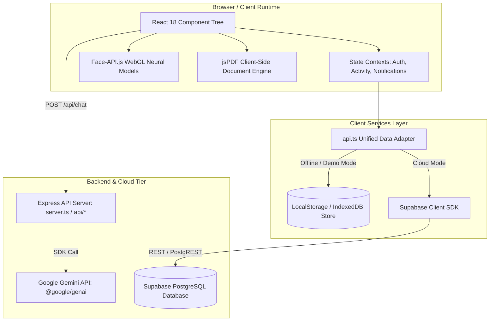
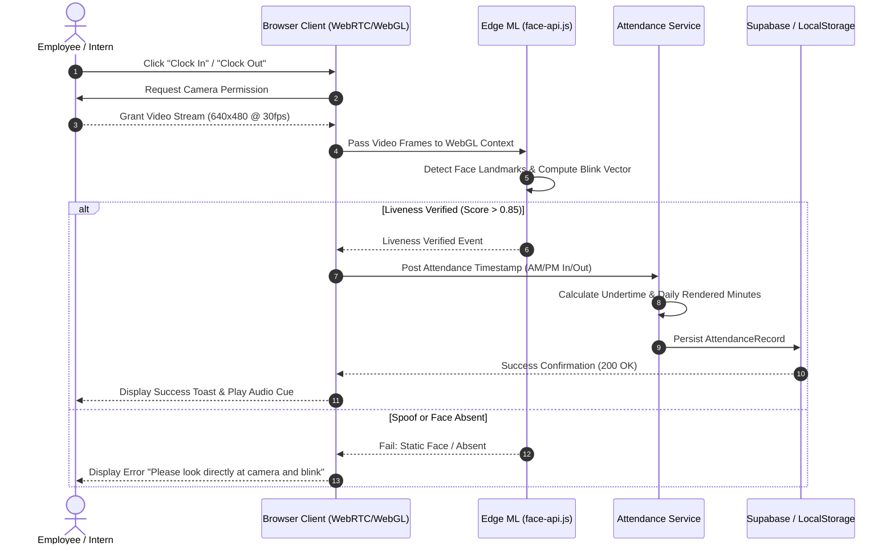

# Technical Requirements Document (TRD)
## TrackMyHours — System Architecture, Engineering Specifications & Data Contracts

---

## 1. System Architecture Overview

TrackMyHours is architected as a high-performance, dual-mode full-stack web application. It combines an edge-optimized React 18 Single-Page Application (SPA) with a lightweight Node.js/Express server layer, offering cloud persistence via Supabase PostgreSQL or zero-config local storage fallback.



---

## 2. Technology Stack & Dependencies

| Layer | Technology | Version | Purpose & Rationale |
| :--- | :--- | :--- | :--- |
| **Frontend Framework** | React | `^18.3.1` | Component-based declarative UI with high rendering efficiency. |
| **Language** | TypeScript | `~5.8.2` | Strong type guarantees across attendance models, roles, and payloads. |
| **Build Tool** | Vite | `^6.2.0` | Ultra-fast Hot Module Replacement (HMR) and optimized rollup bundling. |
| **Styling** | Tailwind CSS | `^3.4.17` | Utility-first, zero-runtime CSS system with custom enterprise brand tokens. |
| **Routing** | React Router DOM | `^6.22.3` | Hash-based client routing (`HashRouter`) for seamless hosting without server rewrites. |
| **Icons** | Lucide React | `^0.359.0` | Accessible, tree-shakeable SVG icon set. |
| **Biometric ML** | `@vladmandic/face-api` | `^1.7.12` | Client-side neural models (SSD Mobilenet v1 / TinyFace) for liveness & landmark tracking. |
| **PDF Engine** | `jspdf` & `jspdf-autotable` | `^2.5.1` / `^3.8.2` | Deterministic client-side generation of Form 48 compliant PDF records. |
| **AI SDK** | `@google/genai` | `^0.1.1` | Google Gemini 2.5 Flash SDK for conversational chat and tool-calling functions. |
| **Backend Runtime** | Node.js / Express | `^4.19.2` | Micro-backend handling Gemini API proxying and production routing. |
| **Cloud Storage** | Supabase JS | `^2.39.8` | Managed PostgreSQL with Row-Level Security (RLS) policies. |

---

## 3. Component & Layer Architecture

### 3.1 Presentation Layer
* **Role-Guarded Portals:** Routes are dynamically protected via `UserRole` guards (`SUPER_ADMIN`, `ADMIN`, `EMPLOYEE`, `STUDENT`).
* **Shared Component Library:**
  * `Button`: Variant-driven atomic buttons (primary, outline, danger, ghost).
  * `Input`: Accessible input wrappers with validation, iconography, and error messaging.
  * `FaceLiveness`: WebRTC camera interface invoking `face-api.js` for facial landmark and blink detection.
  * `QRScanner`: Real-time barcode/QR reader via camera video feed.
  * `ChatBot`: Draggable/floating AI widget with multimodal upload and simulated tool dispatches.

### 3.2 Service Abstraction Tier (`services/api.ts`)
The application implements an **Adapter Pattern** that shields the UI from knowing whether it is connected to Supabase or running locally:

```typescript
// Unified API Surface Contract
export interface DataAdapter {
  init(): Promise<void>;
  students: EntityService<User>;
  employees: EntityService<User>;
  admins: EntityService<User>;
  attendance: AttendanceService;
  notifications: NotificationService;
  logs: LogService;
  documentLinks: DocumentLinkService;
}
```

* **Condition Check:** If `VITE_SUPABASE_URL` and `VITE_SUPABASE_ANON_KEY` are defined, the adapter routes operations to PostgreSQL tables.
* **Fallback Seeding:** If unconfigured or offline, `services/dummyData.ts` hydrates `localStorage` with a complete enterprise snapshot.

---

## 4. Hardware & Client Runtime Requirements



### 4.1 Client Prerequisites
* **Webcam:** Minimum resolution 640x480 @ 30fps.
* **WebGL Support:** WebGL 1.0/2.0 required for TensorFlow/face-api GPU acceleration.
* **Permissions:** `camera`, `geolocation` (optional for IP/location auditing).
* **Network Latency:** `< 300ms` for cloud calls; `0ms` for local fallback.

---

## 5. Security & Privacy Architecture

### 5.1 Government Data Sanitization Protocol
1. **Zero Production Credentials:** Hardcoded agency API secrets, employee credentials, and private keys are removed.
2. **Deterministic Mock Generators:** All sample names, IDs, institutions, and provincial assignments are synthetic.
3. **Row-Level Security (RLS):** Supabase policies isolate user modifications to their authenticated identities while permitting read-access across verified organizational units.

### 5.2 Biometric Privacy Protection
* **No Raw Image Storage:** Raw webcam footage is evaluated in volatile client memory and immediately discarded.
* **Client-Side Landmark Processing:** Face mesh points are transformed into an ephemeral vector; no biometric templates are transmitted across unencrypted channels.

---

## 6. PDF Engine Technical Specifications (Form 48)

The DTR output strictly follows government timekeeping dimensional standards:

* **Paper Dimensions:** Standard Letter (`8.5 x 11 inches` / `215.9 x 279.4 mm`).
* **Table Coordinates:** Two-column mirrored layout (Duplicate Form 48 on a single page for cutting/filing).
* **Column Metrics:**
  * Day of Month (1 - 31)
  * AM Arrival (`amIn`) & AM Departure (`amOut`)
  * PM Arrival (`pmIn`) & PM Departure (`pmOut`)
  * Undertime Hours & Minutes
* **Footer Blocks:**
  * Certification of true and correct record signed by the user.
  * Verification signature of the designated Head of Agency / In-Charge.
